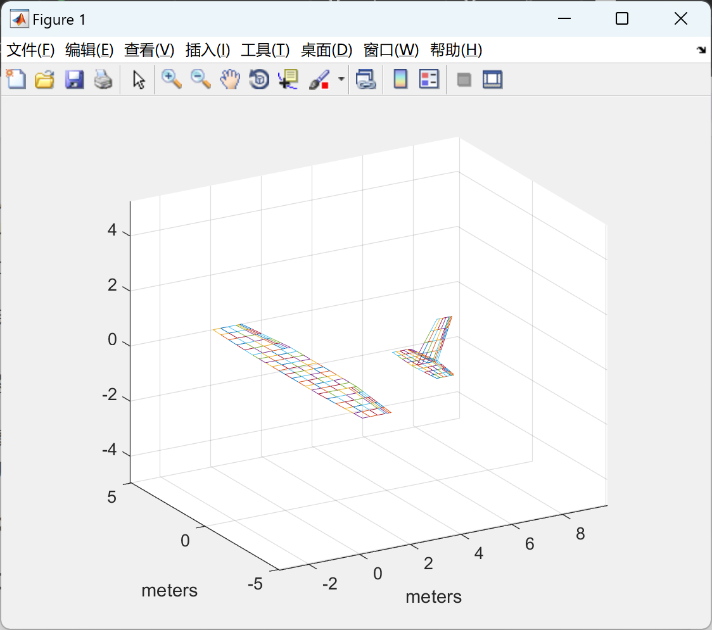
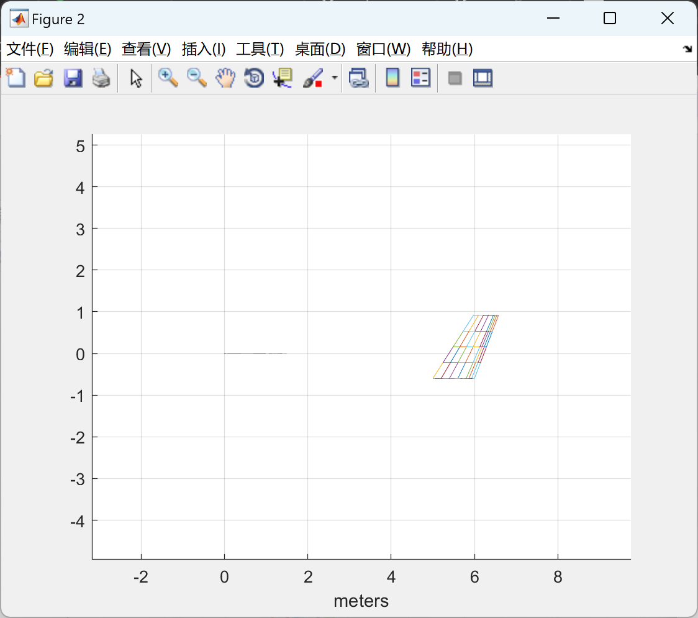
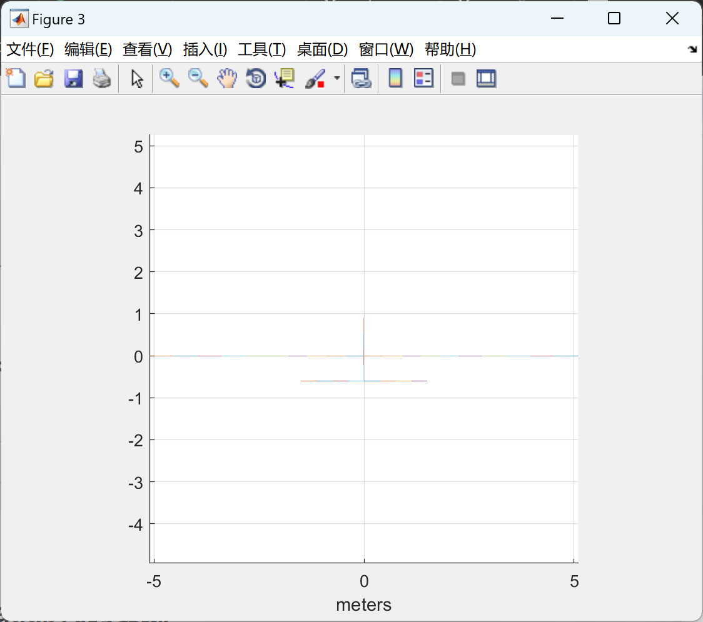
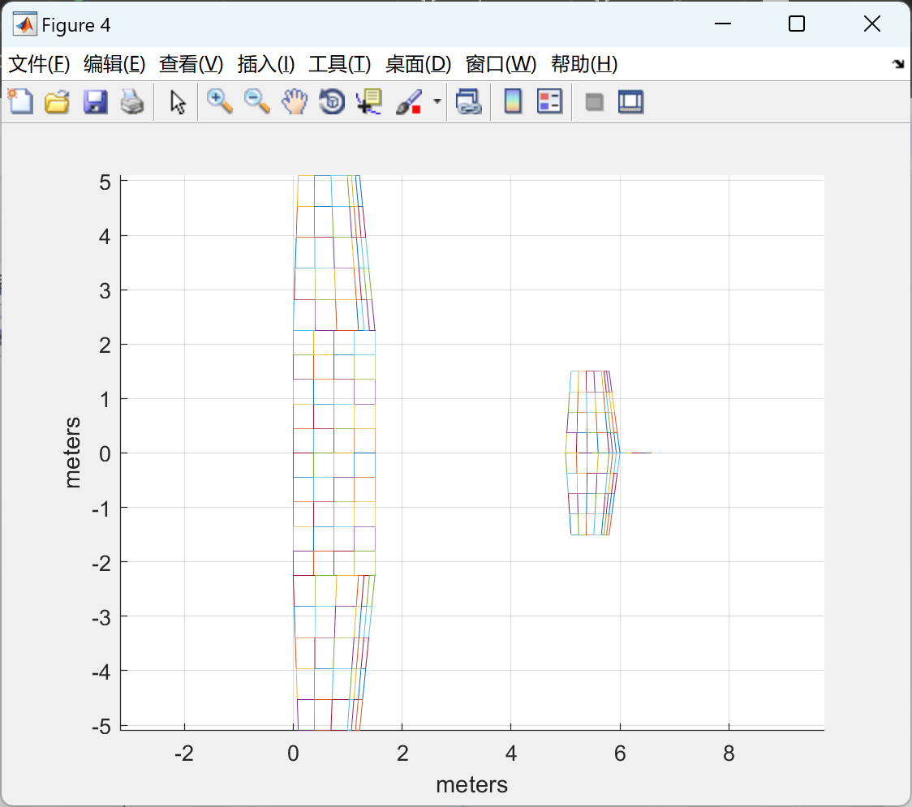

# Compact vortex grid method for calculating aerodynamics of fixed-wing aircraft (Matlab code implementation)

💥💥💞💞 Welcome to this blog❤️❤️💥💥
🏆 Bloggers' Advantage: 🌞🌞🌞 The content of the blog strives to be rigorous in thought and clear in logic, for the convenience of readers.
⛳️ Mantra: The journey of a hundred miles is half done in the last ninety.
📋📋📋This article is organized as follows: 🎁🎁🎁Table of Contents💥1 Overview📚2 Running Results🎉3 References🌈4 MATLAB Code Implementation
💥1 Overview of fixed-wing aircraft is a type of flying vehicle capable of airborne flight, where the aerodynamic performance plays a crucial role in the design and performance of the aircraft. The compact vortex grid method is a numerical approach used for calculating the aerodynamics of fixed-wing aircraft. It discretizes the aircraft's geometry into small elements and uses vortices on the grid to simulate the flow over the aircraft surface, thereby computing lift, drag, and other aerodynamic characteristics of the aircraft.
Research on the aerodynamics of fixed-wing aircraft using the compact vortex grid method can help engineers and designers better understand the flight characteristics of aircraft, optimize the design of aircraft, and enhance the performance and safety of aircraft. Additionally, this method can be used to simulate the aerodynamic performance of aircraft under different flight conditions, providing important data support for the control and flight characteristic research of aircraft.
QuadAir is a software used for calculating the aerodynamic performance of aircraft, which can simulate the aerodynamic forces and moments of an aircraft under different flight conditions. Using QuadAir, one can perform calculations and analyze the aerodynamic performance of the Cessna 152, including the calculation of lift, drag, side force, and pitching moment parameters.
To calculate the aerodynamic forces and moments of the Cessna 152 using QuadAir, first establish the geometric model and flight state of the aircraft, followed by numerical simulation calculations. These computations yield data on the aerodynamic performance of the Cessna 152 under different flight conditions, providing crucial references and support for aircraft design and performance evaluation. Using QuadAir to calculate the aerodynamic forces and moments of the Cessna 152 can help engineers and designers better understand the aircraft's aerodynamic characteristics, providing essential data support for aircraft design and performance optimization.
In summary, the compact vortex grid method is an important research tool for the study of aerodynamics of fixed-wing aircraft, playing a significant role in the design, optimization, and performance improvement of aircraft.
📚2 Run Results
​
​
​
​
Partial code:
%% Aircraft geometry parameters
Aircraft.r_CG_bo = [-0.375, 0, 0]; % position of CG with respect to apex of first wing, in Standard Frame (X: front, Y: right side, Z: down)
Aircraft.symmetry = [1];  // Indicates which wings have symetry about the X-Z plane
Aircraft.n_prt_wng = [3];  // Number of partitions per wing
Aircraft.flapped = [0 1 0];   % Indicates which partitions are flapped  
Aircraft.flp_frac = [0 0.2 0] ;  % Indicates the chord fraction occupied by the flap at eah partition. If partition is UNFLAPPED then set to 0.  
Aircraft.spn   = [6 7 4]*1.5/17;   % Span (including the symmetric part if exists) of each partition of each wing  
Aircraft.root_chrd = [2.2]*1/17;   % Root chord of each wing  
Aircraft.tpr_rto = [2.2 1.9 0.5]*1/2.2;    % Taper ratio of each partition of each wing  
Aircraft.swp_angle = [0 0 25]*pi/180; % Sweep angle of each partition of each wing  
Aircraft.dih_angle = [0 0 10]*pi/180; % Dihedral angle of each partition of each wing  
Aircraft.xyz_000 = [0   0   0];  % XYZ Position of the apex of each the wing, in Geometric Frame (X: back, Y: right side, Z: up). First one should be (0, 0, 0), to make it the reference point  
Aircraft.twst_ang = [+2  +2  +2 +2]*pi/180; % Angle of incidence of each station of each wing (NOTE: each wing has #partitions+1 stations)  
Aircraft.airfoil = {0 0 0};   % Airfoils are defined as an X-Y column matrix going continuously from TE to LE and all the way back to TE.  
% Define airfoild drag polar with parabolic approximation: cd = cd_0 + cd_1*cl + cd_2*cl^2  
% Assume NACA 2412 for main wing, and NACA 0009 for horizontal and vertical tail  
Aircraft.cd_0 = [0.0151 0.0151 0.0151];  
Aircraft.cd_1 = [-0.0126 -0.0126 -0.0126];  
Aircraft.cd_2 = [0.0083 0.0083 0.0083];  
Aircraft.wng_con_surf      = [0];   % Indicating which wings are full control surfaces. The whole wing is rotated.  
Aircraft.wng_con_surf_axis_rot = [0 1 0]; % Specifying the axis of rotation of each full wing control surface.  
Aircraft.con_surf_group = [1        % Indicates grouping of control surfaces and symmetric/anti-symmetric relation  
1];  
%% Geometric Discretization Parameters  
% The structure "geo_disc" holds the relevant geometric disretization parameters.  
% UNFLAPPED part  
geo_disc.spn_div(1,:,1) = [5 5 3];   % Number of span-wise divisions for the UN-FLAPPED part of each partition of each wing  
geo_disc.chrd_div(1,:,1) = [5 4 3];   % Number of chordwise-wise divisions for the UN-FLAPPED part of each partition of each wing  
% FLAPPED part  
geo_disc.spn_div(1,:,2) = geo_disc.spn_div(:,:,1);   % Set to be equal in FLAPPED and UN-FLAPPED parts.  
geo_disc.chrd_div(1,:,2) = [0 3 0];   % Number of chordwise-wise divisions for the FLAPPED part of each partition of each wing  
🎉3 References
[2] Liu Feng. Research on Anti-disturbance Control Method for Large Aerodynamic Angle Flight of Fixed Wing Aircraft [J]. [2024-01-15].
🌈4 Matlab code implementation

## Images

<!-- PAYMENT_BLOCK -->

## Get this dataset

- Payment link (Stripe): [Buy now](https://buy.stripe.com/3cs8yP7sY87d0vu9AB)
- Payment QR code: 

<!-- /PAYMENT_BLOCK -->
